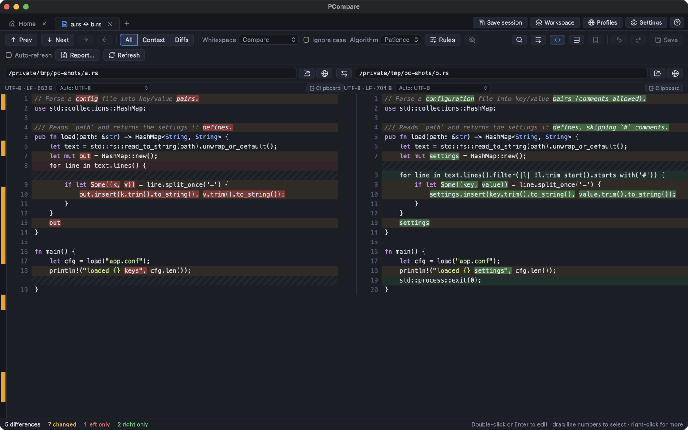
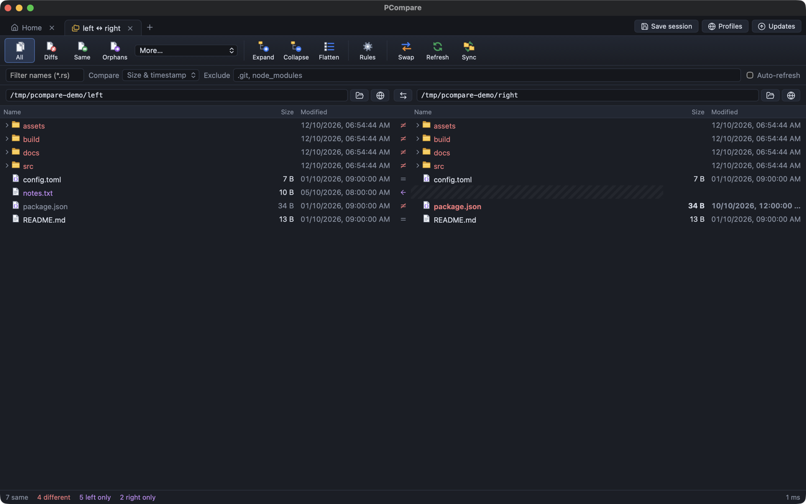
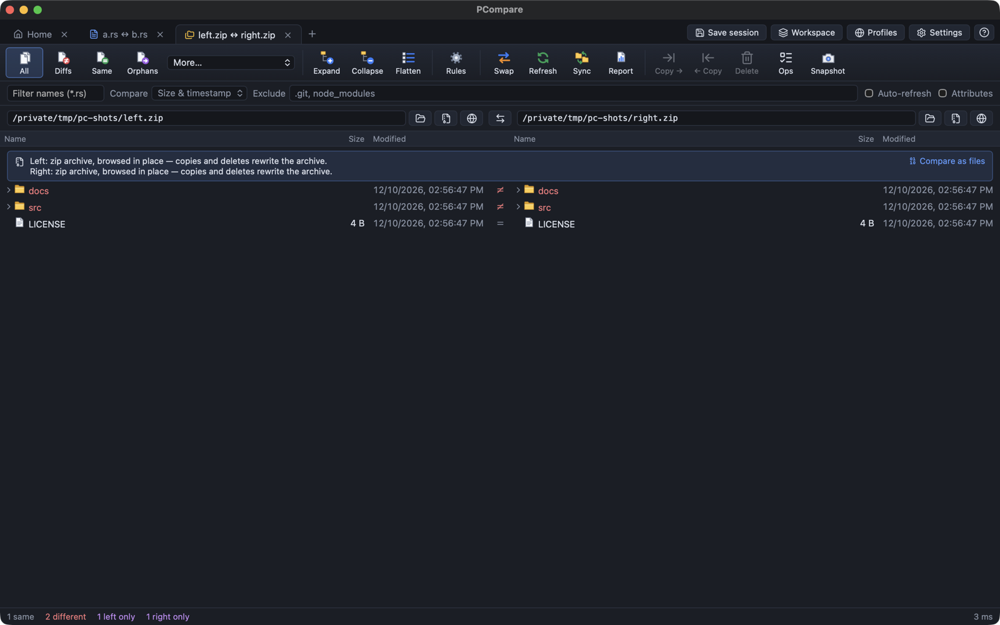
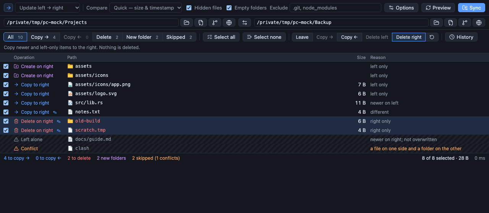
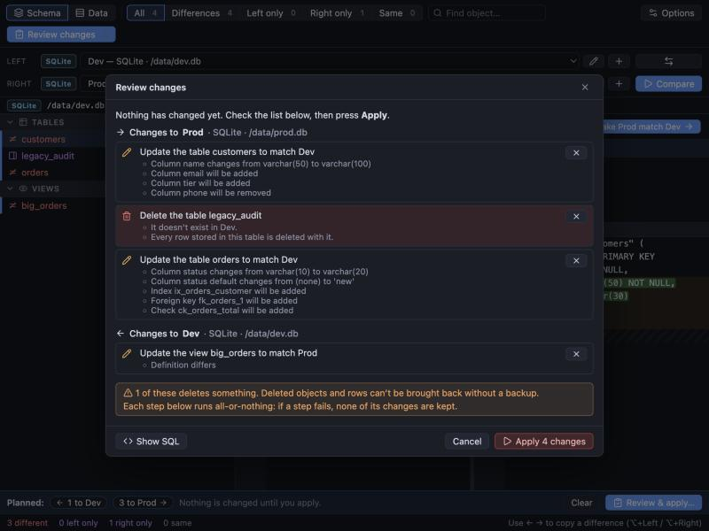
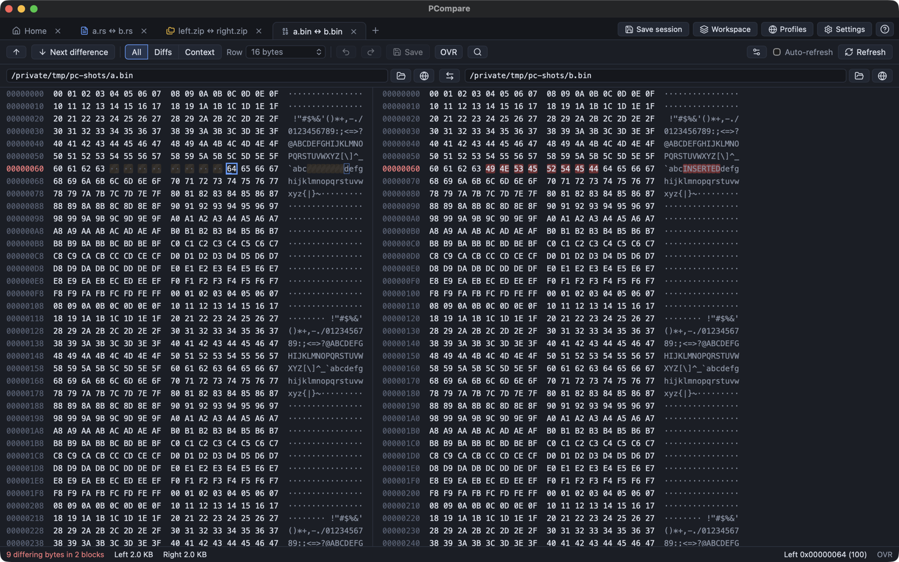
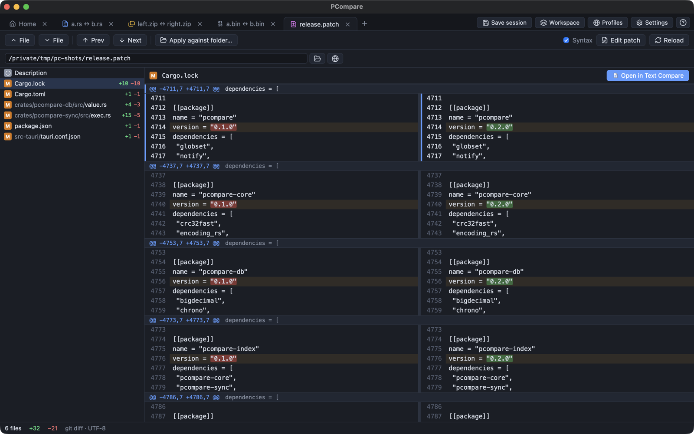
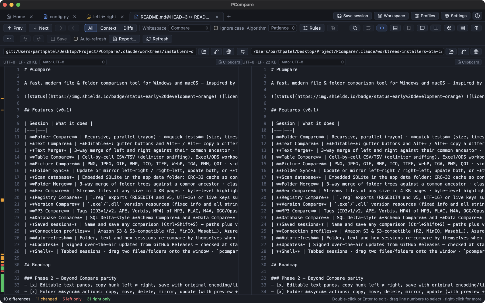
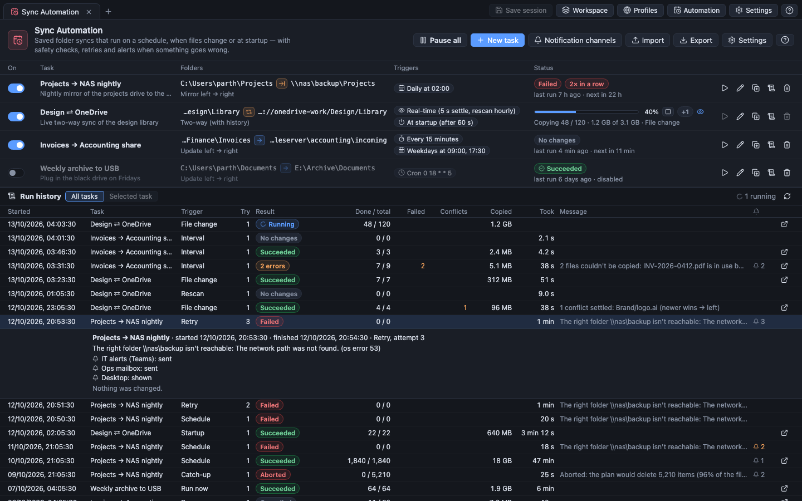

# PCompare

**Compare, merge and sync files, folders, archives, cloud drives and databases, with a preview before anything changes.**
A fast, free and open-source desktop app for Windows and macOS, built with Rust, Tauri 2 and React.

[](https://github.com/parthh37/PCompare/releases/latest)
[](https://github.com/parthh37/PCompare/actions/workflows/ci.yml)

[](LICENSE)

**[Website](https://parthh37.github.io/PCompare/)** · **[Download](https://github.com/parthh37/PCompare/releases/latest)** · [Features](#features) · [Command line](#command-line) · [Scripts](#scripts) · [Building from source](#building-from-source)



## Download

Get the latest installers from **[GitHub Releases](https://github.com/parthh37/PCompare/releases/latest)**, or from the [website](https://parthh37.github.io/PCompare/):

| Platform | File |
|---|---|
| Windows 10 / 11 (x64) | `PCompare_<version>_x64-setup.exe` (recommended) or `PCompare_<version>_x64_en-US.msi` |
| macOS, Apple Silicon | `PCompare_<version>_aarch64.dmg` |
| macOS, Intel | `PCompare_<version>_x64.dmg` |

Installed copies update themselves: PCompare checks for signed updates at startup and every 6 hours, and installs one with a single click. macOS builds without a Developer ID are ad-hoc signed, so on first launch right-click the app → **Open** (or allow it under *System Settings → Privacy & Security*).

## Highlights

- **15+ viewers in one app**: text, folders, tables, pictures, hex, databases, 3-way text and folder merge, registry, executables, audio tags, patches.
- **Previews before changes.** Folder Sync lists every copy and delete first; Database Compare explains its changes in plain words before running any SQL.
- **Fail-safe by design.** Atomic copies, journaled runs you can resume or roll back, locked-file handling, and deletions to the Recycle Bin / Trash.
- **Everywhere your files are.** Local folders, zip / tar / 7z archives, `git:` / `hg:` / `svn:` revisions, S3, Azure, GCS, B2, FTP, SFTP, WebDAV, OneDrive, SharePoint, Dropbox, Google Drive and GitHub.
- **Automation.** Scheduled and real-time folder syncs with safety checks, retries, history and alerts to Teams, Slack, email or webhooks.
- **Built for the command line.** Quick compares, headless merges and a compare-script language with standard exit codes for CI, git hooks and nightly jobs.

## Screenshots

<table>
  <tr>
    <td width="50%"><a href="docs/screenshots/folder-compare.png"></a><br><b>Folder Compare</b>: quick tests, content compare and display filters</td>
    <td width="50%"><a href="docs/screenshots/folder/archive-as-folder.png"></a><br><b>Archives as folders</b>: zip, tar and 7z browsed and edited in place</td>
  </tr>
  <tr>
    <td width="50%"><a href="docs/screenshots/sync-preview-row-overrides.png"></a><br><b>Folder Sync</b>: every operation previewed, with per-row overrides</td>
    <td width="50%"><a href="docs/screenshots/db-arrows-schema-review.jpg"></a><br><b>Database Compare</b>: pick changes with arrows, review them in plain words</td>
  </tr>
  <tr>
    <td width="50%"><a href="docs/screenshots/hex/aligned.png"></a><br><b>Hex Compare</b>: byte-level differences with inserted bytes aligned</td>
    <td width="50%"><a href="docs/screenshots/patch/viewer.png"></a><br><b>Patch Viewer</b>: browse a <code>.patch</code> file by file and apply it to a folder</td>
  </tr>
  <tr>
    <td width="50%"><a href="docs/screenshots/vcs/git-side.png"></a><br><b>Version control</b>: compare against <code>git:&lt;path&gt;@HEAD~3</code>, with a blame gutter</td>
    <td width="50%"><a href="docs/screenshots/automation-page.png"></a><br><b>Sync Automation</b>: scheduled and real-time syncs with run history and alerts</td>
  </tr>
</table>

## Features

### Viewers

| Viewer | What it does |
|---|---|
| **Text Compare** | Side-by-side aligned diff with word-level highlights; both sides editable (copy differences across, drag lines, undo/redo, save with the original encoding, BOM and line endings) · All / Diffs / Same / Context views and a *Minor* toggle for unimportant differences · rules for whitespace, case, regex-defined and numeric-tolerance text, ignored blocks, language grammars · Patience or Myers · sync points and a linked (unpadded) layout · moved-block detection · git blame gutter · bookmarks and comments |
| **Text Merge** | 3-way merge against a common ancestor: one-sided changes merged automatically, conflicts taken left / right / both / base or edited in the output · per-line origin markers · works as a `git mergetool` |
| **Folder Compare** | Recursive and parallel, with rows streaming in while large trees are scanned · quick tests (size, timestamp with tolerance) then optional content compare (binary, CRC-32 or rules-based) · display filters, structure modes, name / size / date / attribute filters · file operations with a background operations panel · split view, select by criteria, reports, snapshots, statistics |
| **Folder Sync** | Update, mirror, update both, two-way with history, or a custom per-category matrix · preview with per-row overrides · fail-safe execution with pre-flight checks, verification, locked-file retries, pause / resume · versioning, journaled runs, resume and rollback |
| **Folder Merge** | 3-way merge of folder trees with a proposed action per path; text conflicts resolve in Text Merge |
| **Table Compare** | CSV / TSV, Excel / ODS workbooks and HTML tables cell by cell · rows by key columns or order · column mapping · case, whitespace, numeric and date tolerances |
| **Picture Compare** | PNG, JPEG, GIF, BMP, ICO, TIFF, WebP, TGA, PNM, QOI · highlight, difference, blend and swipe views · per-channel tolerance · synced zoom and pan |
| **Hex Compare** | Files of any size, streamed in pages · aligned inserted bytes · editable |
| **Database Compare** | Schema and data compare for SQL Server, MySQL / MariaDB, PostgreSQL and SQLite · tables, views, procedures, functions, triggers, sequences with side-by-side DDL · rows matched by key with cell-level differences · pick changes with ← / → arrows, review them in plain words, then apply in all-or-nothing batches (*Show SQL* to see the statements) |
| **Registry Compare** | `.reg` exports or live keys on Windows |
| **Version Compare** | `.exe` / `.dll` version resources and PE header facts (architecture, ASLR / DEP / CFG, signature) |
| **MP3 Compare** | Tags and audio properties of MP3, FLAC, M4A, OGG / Opus, WAV and AIFF, with cover art |
| **Text Edit** | A standalone editor for one file, fast on 100k+ line files |
| **Patch Viewer** | Unified, git and context diffs side by side; dry-run against a folder and apply selected hunks |
| **Comparison archives** | Save a comparison with its comments as a single `.pcmpz` file and review it on another machine |

### Everywhere else

- **Sources**: archives as folders (zip, tar, tar.gz / bz2 / xz, 7z; zip is writable), folder snapshots (`.pcsnap`), `git:` / `hg:` / `svn:` revisions, and remote profiles for Amazon S3 and compatibles, Azure Blob, Google Cloud Storage, Backblaze B2, FTP / FTPS, SFTP, WebDAV, OneDrive, SharePoint, Dropbox, Google Drive and GitHub (read-only). Secrets live in the OS keychain; saved connection lists are encrypted (AES-256-GCM).
- **Documents**: Word (docx, doc), OpenDocument, RTF and PDF compared as text, with per-extension file-format rules and external converters.
- **Sync Automation**: interval, daily / weekly, cron, real-time and at-startup triggers · empty-side and mass-deletion guards, timeouts, retries · notifications to Microsoft Teams, Slack, email (SMTP), webhooks and the desktop · runs from the tray and at sign-in.
- **Sessions & workspaces**: saved sessions, auto-saved recent sessions, named workspaces of open tabs, and import of saved sessions from other compare and sync tools.
- **Reports**: HTML, text, unified patch and CSV for text, folder and table comparisons; copy, save or print.
- **Integration**: Windows Explorer menu (*Select Left Side* / *Compare to…*), one-click git difftool / mergetool setup, snippets for Mercurial, Perforce and Subversion, single-instance tabs.
- **Look & feel**: dark, light or system theme, custom diff colours and fonts, rebindable shortcuts, built-in help (F1).

## Command line

```text
pcompare [options] <left> [<right>]                  compare two files or folders
pcompare [options] <left> <right> <base> [<output>]  3-way merge (the usual mergetool order)
pcompare @<script> [<param>…] [/silent] [--dry-run]   run a compare script without a window
pcompare /qc[=size|crc|binary|rules] <left> <right>   quick compare without a window
pcompare <left> <right> <base> <output> /automerge    merge without a window (git mergetool)
```

Switches take the Windows-style spelling (`/name=value`, case-insensitive) or a GNU-style one (`--name value` /
`--name=value`); `/`-switches are recognised only by their exact names, so `/Users/…` stays a path.

| Switch | What it does |
|---|---|
| `/fv=<viewer>`, `--viewer <kind>` | Open as a specific session: `text`, `hex`, `table`, `picture`, `folder`, `sync`, `merge`, `folderMerge`, `registry`, `version`, `mp3`, `database` (display names such as `"Text Compare"` or `"Data Compare"` work too) |
| `/title1=<text>`, `/title2=<text>`, `--title-left`, `--title-right` | Tab labels instead of the file names (handy for git's temporary files); `/title3=`, `/title4=` (`/centertitle=`, `/outputtitle=`) label a merge's base and output, and `/vcs1=`…`/vcs4=` stand in for missing titles |
| `/readonly` (`/ro`), `/lro` (`/ro1`), `/rro` (`/ro2`), `--readonly[-left\|-right]` | Open sides read-only in Text Compare |
| `/mergeoutput=<path>`, `--merge-output <path>` | Where a 3-way merge writes its result (implies `--wait`) |
| `/center=<path>` | The merge base, instead of the third path |
| `/automerge` | Merge without a window and write the output — unless there are conflicts: then `/force` writes them with `<<<<<<<` markers, `/reviewconflicts` opens the merge in PCompare (and waits for it), and otherwise the output is left alone. `/iu` makes whitespace-only changes merge cleanly, taken from `/favorleft` / `/favorright` or else from the base |
| `/filters=<masks>`, `/expandall`, `/savetarget=<path>`, `/sync`, `/edit` | Accepted with their usual meaning (`/sync` and `/edit` pick the viewer); `/solo`, `/nobackups` and `/closescript` are accepted and ignored |
| `/wait`, `--wait` | Don't return until the comparison's tab is closed — also when PCompare is already running. Exit code `0`, or `1` for a merge whose output was never saved |
| `--base-first` | Merge paths come as `<base> <theirs> <yours> <merged>` (P4MERGE, svn `merge-tool-cmd`) |
| `-L <label>` | Labels the next side, as `svn diff --diff-cmd` passes them |
| `/qc[=<method>]`, `--quick-compare[=<method>]` | Compare headlessly and print one line. `rules` (default) applies the text rules to text files and compares other files byte by byte; `binary`, `crc` and `size` are stricter or quicker. Folders are compared recursively |
| `@<file>`, `/silent`, `--dry-run` | Run a script (below); `/silent` prints only errors; `--dry-run` lists file operations instead of performing them |
| `--select-left <path>`, `--compare-to <path>` | Explorer's "Select Left Side" / "Compare to" |
| `-h`, `--help`, `/?` | Usage |

Exit codes follow the common compare-tool convention, so existing CI jobs and hooks work unchanged:

| Code | Quick compare (`/qc`) | Script (`@file`) | `/automerge` |
|---|---|---|---|
| 0 | | success | merged |
| 1 | binary same | | |
| 2 | rules-based same (only encoding or line endings differ) | | |
| 11 | binary differences | | |
| 12 | similar (only unimportant differences) | | |
| 13 | rules-based differences | | |
| 14 | | | conflicts, written with markers (`/force`) |
| 100 | error | some commands failed | error |
| 101 | | | conflicts, output not written |
| 105 / 106 / 107 | | script unreadable / syntax error (nothing ran) / a `load` failed (the script stops there) | |

> **Changed in 1.5:** quick compare used to exit `0` for same and `1` for different, and scripts `1` and `2` for
> errors. Scripts testing `%ERRORLEVEL% == 0` after `/qc` must now test for `1` or `2` (or `< 11` for "not
> different").

With PCompare already open, a new `pcompare <paths>` (switches included) opens a tab in that window.

On Windows the installed `pcompare.exe` is a GUI program: `cmd.exe` doesn't wait for it, so use
`start /wait pcompare.exe /qc a b` (or PowerShell's `Start-Process -Wait`) to read `%ERRORLEVEL%`; output goes to the
console the command was typed in, or wherever it is redirected (`> result.txt`).

## Reports

**Report…** in Text Compare, Folder Compare (toolbar) and Table Compare saves, copies or prints the comparison:

- **Text**: side-by-side or unified layout, all lines or differences only with *N* context lines, as HTML (the app's
  diff colours with changed-word highlights), plain text or a unified patch (`patch` / `git apply`); line numbers,
  ignore unimportant differences, black and white. Unsaved edits are included.
- **Folder**: summary (status and path) or detailed (both sides with sizes and dates), honouring the display filter
  and name filter (or differences only / everything), as HTML, text or CSV. *Link to file comparison reports* writes a
  text report for every differing text file into `<report>_files/` next to the saved HTML report and links it.
- **Table**: an HTML grid with differing cells highlighted (left value over right value), or CSV.

Copying HTML puts rich text on the clipboard (pastes formatted into Word or mail). Printing uses the webview's print
dialog on Windows and Linux; on macOS, whose web view can't print, the report opens in the default browser with its
print dialog.

## Scripts

`pcompare @nightly.txt "D:/work" "E:/backup"` runs a compare script without opening a window; the classic
sample scripts run unchanged. One command per line (a trailing `&` continues it on the next line), keywords are
case-insensitive, `#` starts a comment (a whole line, or after a space at the end of one), arguments with spaces go in
double quotes, `%1`–`%9` are the parameters after the script name, `%date%` (`2012-12-31`), `%time%` and `%fn_time%`
(`23-59-59`, safe in file names) are the current date and time, and `%NAME%` is an environment variable. `lt` and
`rt` stand for `left` and `right`. The whole script is checked before anything runs.

```text
# Mirror a project to a backup and keep a report of what changed.
log verbose append:"%TEMP%/backup %date%.log"
criteria timestamp:2sec size
filter "-target\;-node_modules\;-*.tmp"
load "%1" "%2"
expand all
folder-report layout:side-by-side &
   options:display-mismatches,include-file-links,column-size,column-crc &
   output-to:"%2/../changes.html" output-options:html-color
sync create-empty mirror:left->right
```

Base folders can be local folders, zip / tar / 7z archives, snapshots (`.pcsnap`, or saved by a script under the legacy
`.bcss` name), `svn:` / `git:` / `hg:` revisions, `remote://<connection>/<path>`, or script-style `ftp://user@host/path`
and `sftp://…` URLs, which use the saved connection for that host. Writes to remote folders and zip archives go
through the same fail-safe executors as the app.

| Command | |
|---|---|
| `log [none\|normal\|verbose] [[append:]<file>]` | Log commands, results and errors (verbose: every file operation); `Log.txt` by default, `none` stops logging |
| `criteria [timestamp[:Nsec;IgnoreDST]] [size\|crc\|binary\|rules-based] [version] [attrib:<ashr>] [timezone:<ignore\|left±N\|right±N>] [follow-symlinks] [ignore-unimportant]` | How files are compared (default `timestamp size`) |
| `filter "<mask>;-<mask>;<folder>\;-<folder>\"`, `filter cutoff:<[<\|>]<date>\|<N>days\|none>`, `filter size:<[<\|>]N[KB\|MB\|GB]\|none>`, `filter attrib:<±ashr\|none>`, `filter exclude-protected\|include-protected` | Name masks (a trailing `\` or `/` means a folder), and files older / newer, smaller / larger, or with / without attributes |
| `load <left> [<right>]`, `load <session>`, `load <default>`, `load create:<all\|left\|right> …` | Compare two folders (or files), open a saved session by name, go back to the default settings, create missing base folders. A failed load ends the script (exit 107) |
| `expand all\|<folder>…`, `collapse all\|<folder>…` | Like the folder view: `select` and reports only see expanded folders' contents |
| `select <side>.<status>.<type>…`, `select empty.folders` | e.g. `all.diff.files`, `left.orphan`, `right.newer.files`, `all`; side `left\|right\|all`, status `all\|diff\|same\|exact\|orphan\|newer\|older`, type `files\|folders` |
| `compare [crc\|binary\|rules-based]` | Content-compare the selected files |
| `folder-report layout:<summary\|side-by-side\|xml> [options:<display-…>,include-file-links,column-<size\|timestamp\|crc\|attributes\|none>] [title:<text>] output-to:<file> [output-options:<html-color\|html-mono\|text\|csv>]` | Folder report (format defaults to text, or from the file extension) |
| `file-report`, `text-report`, `hex-report`, `data-report`, `picture-report`, `media-report`, `registry-report`, `version-report` with `layout:<side-by-side\|summary\|interleaved\|patch\|statistics\|xml> [options:display-<all\|mismatches\|context\|matches>,line-numbers,ignore-unimportant,patch-<normal\|context\|unified>] output-to:<file> [output-options:…] [<session> \| <left file> <right file>]` | File reports of the loaded files, every selected file pair, or the named comparison. `file-report` reads each pair by the *File formats* rules (documents converted to text) and reports binary files as a hex comparison |
| `sync [visible] [create-empty] <mirror\|update>:<left->right\|right->left>`, `sync update:all` | Synchronize (fail-safe executor: atomic copies, retries, deletions to the Recycle Bin / Trash); `visible` only touches expanded folders |
| `copy\|move <left->right\|right->left>`, `delete [recyclebin=<yes\|no>] <left\|right\|all>` | Copy, move or delete the selection (folders with their contents) |
| `copyto\|moveto [left\|right\|all] [path:<none\|relative\|base>] <folder or .zip>` | Copy or move the selection elsewhere: flat, below the deepest folder they share, or with their full path |
| `rename <mask>`, `rename regexpr <old> <new>` | Rename the selection, DOS-style (`*.bak`) or by regular expression (`$1`) |
| `touch <left->right\|right->left>`, `touch <left\|right\|all>:<now\|<date>>` | Copy or set timestamps of the selection |
| `attrib +r -h …` | Set or clear attributes of the selection (`a`, `s`, `h`, `r`) |
| `snapshot [save-crc] [include-empty] [no-filters] [expand-archives] <left\|right\|path:<folder>> [output:<file or folder>]` | Save a snapshot (honouring the filters unless `no-filters`) |
| `beep` | Sound the terminal bell |
| `option confirm:<yes-to-all\|no-to-all\|prompt>` | Overwrites and deletions need confirmation: asked on the terminal (`prompt`, the default), never asked with `/silent` (skipped) |
| `option stop-on-error`, `option recycle:<yes\|no>` | Stop at the first failing command (otherwise the script goes on and exits with 100); delete permanently instead of to the Recycle Bin |

`printer` and `clipboard` outputs need the window; `column-version`, `column-owner`, `column-group`, `column-vcs` and
`snapshot save-version` are accepted but not filled in.

## Version control

**Revisions as sides.** Any path field (and the command line) takes `git:<path>[@<revision>]` or
`hg:<path>[@<revision>]`: a file or folder of a clone at that revision, read through the `git` / `hg` client and
read-only. `git:C:\src\app\main.c@HEAD~1` against `C:\src\app\main.c` shows your uncommitted change;
`git:/src/app@v1.2` against `git:/src/app@origin/main` compares two trees in Folder Compare. Without `@`, `HEAD`
(git) or `.` (hg) is used. The branch button next to a path field picks a revision from the history.

**git difftool / mergetool.** *Settings → Source control → Set up git…* shows these commands and runs them when you
confirm (the path is the installed `pcompare` executable):

```bash
git config --global difftool.pcompare.cmd '"C:/Program Files/PCompare/pcompare.exe" --wait "$LOCAL" "$REMOTE"'
git config --global mergetool.pcompare.cmd '"C:/Program Files/PCompare/pcompare.exe" --wait "$LOCAL" "$REMOTE" "$BASE" "$MERGED"'
git config --global mergetool.pcompare.trustExitCode true
git config --global diff.tool pcompare     # optional: make it the default
git config --global merge.tool pcompare
```

`--wait` keeps the process alive until you close that tab, even with PCompare already open, so git doesn't delete
its temporary files early; a merge closed without saving its output exits with 1, which `trustExitCode` reports as an
unresolved merge. Add `/title1="$BASE (old)" /title2="$BASE (new)"` to the difftool command for readable tab names.
To check whether two revisions differ without a window: `pcompare /qc "$LOCAL" "$REMOTE"` (exit code 1 or 2 when
they're the same, 11–13 when they differ). For merges without a window:
`pcompare "$LOCAL" "$REMOTE" "$BASE" "$MERGED" /automerge /reviewconflicts` writes clean merges straight away and
opens only the ones with conflicts.

**Mercurial, Perforce, Subversion.** The same Settings page has copy-paste snippets, e.g. for `~/.hgrc`:

```ini
[extdiff]
cmd.pcompare = /Applications/PCompare.app/Contents/MacOS/PCompare
opts.pcompare = --wait

[merge-tools]
pcompare.executable = /Applications/PCompare.app/Contents/MacOS/PCompare
pcompare.args = --wait $local $other $base $output
pcompare.gui = True
```

Perforce: `P4DIFF="pcompare --wait"`, `P4MERGE="pcompare --wait --base-first"`, or in P4V *Other application* with
arguments `--wait %1 %2` (diff) and `--wait %2 %1 %b %r` (merge). Subversion: `svn diff --diff-cmd pcompare -x --wait`,
and a two-line `merge-tool-cmd` script calling `pcompare --wait --base-first "$1" "$2" "$3" "$4"`.

## Roadmap

- [ ] Structural diff for JSON, YAML and XML (key-order-insensitive)
- [ ] Semantic (AST-aware) code diff
- [ ] AI-generated summary of a diff
- [ ] Blame for Mercurial
- [ ] Windows 11 top-level context menu

Ideas and bug reports are welcome in [Issues](https://github.com/parthh37/PCompare/issues).

## Building from source

Prerequisites: [Rust](https://rustup.rs), Node.js 20+, and on Windows the [WebView2 runtime](https://developer.microsoft.com/microsoft-edge/webview2/) (preinstalled on Windows 10/11).

```bash
npm install
npm run tauri dev             # run the app with hot reload
cargo test --workspace        # engine tests
npm run tauri build           # installers for the current OS (needs the updater key, see Releasing)
```

### Project layout

```
crates/pcompare-core/        Diff engines (text, folder, hex), sessions, workspaces, sealed config — UI-agnostic, unit tested
crates/pcompare-merge/       3-way text merge (diff3)
crates/pcompare-table/       Table compare: CSV/TSV, Excel/ODS (calamine), HTML tables
crates/pcompare-picture/     Picture compare (image crate)
crates/pcompare-meta/        Registry (.reg / live), executable version (pelite) and audio tag (lofty) compare
crates/pcompare-db/          Database schema/data compare and SQL generation (sqlx, tiberius)
crates/pcompare-sync/        Folder sync planning, fail-safe execution, rollback, 3-way folder merge
crates/pcompare-index/       Embedded SQLite: checksum cache, two-way sync baselines, job journal
crates/pcompare-automation/  Sync Automation: tasks, schedules, real-time triggers, policies
crates/pcompare-notify/      Notifications: Microsoft Teams, SMTP, Slack, webhooks
crates/pcompare-remote/      Connection profiles and remote file systems (OpenDAL, russh SFTP, Graph, GitHub)
crates/pcompare-archive/     Archives, snapshots and git / hg / svn revisions as file systems
crates/pcompare-convert/     Document-to-text converters and file-format rules
crates/pcompare-report/      Text / folder / table reports (HTML, text, patch, CSV)
crates/pcompare-review/      Comparison archives (.pcmpz)
crates/pcompare-script/      Script processor (`pcompare @script.txt`), quick compare (`/qc`), headless merge
crates/pcompare-import/      Saved-session import
crates/pcompare-shell/       Windows Explorer menu verbs
src-tauri/                   Tauri shell exposing the engines as commands
src/                         React + TypeScript UI
site/                        Product website (GitHub Pages)
```

### Releasing

[`.github/workflows/release.yml`](.github/workflows/release.yml) builds **Windows** (NSIS `.exe` + `.msi`) and
**macOS** (Apple Silicon and Intel `.dmg`) installers, signs the update packages, and publishes a GitHub release
with `latest.json` — the feed installed copies poll for updates. The release stays a draft until every
platform has built (~20 min).

**From the browser (easiest):** GitHub → **Actions** → **Release** → **Run workflow** → pick a bump
(`patch` / `minor` / `major`, or `as-is` to release the version already on `main`; the *Exact version* box takes
e.g. `1.0.0-beta.1`) → **Run workflow**. It bumps the version files, commits `Release vX.Y.Z` to `main`, tags
it and builds. Works from the GitHub mobile app too. From a terminal: `gh workflow run release.yml -f bump=minor`.

**By pushing a tag** (also works from any git GUI — create tag `vX.Y.Z` on the commit, push it):

```bash
npm run version:bump 0.2.0         # package.json, Cargo.toml, tauri.conf.json stay in sync
cargo check                        # refresh Cargo.lock
git commit -am "Release v0.2.0" && git tag v0.2.0 && git push --follow-tags
```

Either way the workflow refuses to release a tag that doesn't match the app version — otherwise the updater
would keep offering the same release. `node scripts/version.mjs next minor` previews what a bump would produce.

**One-time setup**

1. **Updater signing key** (required). Updates are verified against the public key in `tauri.conf.json`;
   the private half lives outside the repo at `~/.tauri/pcompare-updater.key`. Add it as the repository
   secret `TAURI_SIGNING_PRIVATE_KEY` (the key has no password, so `TAURI_SIGNING_PRIVATE_KEY_PASSWORD` can be
   left unset). Back the key up — losing it means installed copies can never update again.
   ```bash
   gh secret set TAURI_SIGNING_PRIVATE_KEY < ~/.tauri/pcompare-updater.key
   ```
   For a local `npm run tauri build`, export the same variable first:
   `export TAURI_SIGNING_PRIVATE_KEY="$(cat ~/.tauri/pcompare-updater.key)"`.
2. **macOS signing** (optional). Without an Apple Developer ID the app is ad-hoc signed: on first launch users
   right-click → Open (or allow it under *System Settings → Privacy & Security*). To ship a notarized app, add
   `APPLE_CERTIFICATE`, `APPLE_CERTIFICATE_PASSWORD`, `APPLE_SIGNING_IDENTITY`, `APPLE_ID`, `APPLE_PASSWORD`
   (app-specific) and `APPLE_TEAM_ID` secrets — the workflow picks them up automatically.
3. **Windows signing** (optional). Unsigned installers trigger a SmartScreen warning until the app builds
   reputation; an Authenticode certificate removes it.

### Cloud sign-in (OneDrive, SharePoint, Dropbox, Google Drive)

Users click **Sign in with Microsoft/Google/Dropbox…** in the profile form and approve PCompare in the browser — as long as the build carries PCompare's own OAuth apps. Those are compiled in from environment variables, which the release and PR-bundle workflows read from the repository's Actions **variables** (IDs) and **secrets** (the Google client secret):

| Variable | Provider | One-time setup |
| --- | --- | --- |
| `PCOMPARE_MICROSOFT_CLIENT_ID` | OneDrive + SharePoint | [Entra → App registrations](https://entra.microsoft.com/#view/Microsoft_AAD_RegisteredApps/ApplicationsListBlade) → New: *Accounts in any organizational directory and personal Microsoft accounts*; platform **Mobile and desktop applications**, redirect URI `http://localhost:53682/`. No secret. |
| `PCOMPARE_GOOGLE_CLIENT_ID` + secret `PCOMPARE_GOOGLE_CLIENT_SECRET` | Google Drive | [Cloud console](https://console.cloud.google.com/apis/credentials): enable the Drive API, configure the OAuth consent screen, create an OAuth client of type **Desktop app**. |
| `PCOMPARE_DROPBOX_CLIENT_ID` | Dropbox | [App console](https://www.dropbox.com/developers/apps): scoped app, full Dropbox, redirect URI `http://localhost:53682/`, the `files.*` read/write scopes. |

Desktop OAuth clients can't keep a secret (RFC 8252); the IDs only identify the app and PKCE protects each sign-in. Local builds pick the same variables up from your shell (`export PCOMPARE_MICROSOFT_CLIENT_ID=…` before `npx tauri build`).

Without them — or under **Advanced** in any build — users enter a Client ID of their own, registered the same way.

Google treats full Drive access as a *restricted* scope: until the app passes Google's verification, sign-in shows an "unverified app" warning and is capped at 100 users, and while the consent screen is in *Testing* only listed test users can sign in and their sign-ins expire after 7 days. Set the consent screen to *In production* for personal or small-team use.

### Testing against live servers

`cargo test -p pcompare-remote --test live` is skipped unless `PCOMPARE_LIVE_PROFILES` points at a JSON list of profiles; see the header of `crates/pcompare-remote/tests/live.rs` for the format and fixture layout.

Database Compare's SQLite tests always run. The MySQL, PostgreSQL and SQL Server tests (`crates/pcompare-db/tests/live_*.rs` and the end-to-end `roundtrip.rs`, which syncs two databases and expects an identical re-compare) run when `PCOMPARE_LIVE_MYSQL`, `PCOMPARE_LIVE_POSTGRES` or `PCOMPARE_LIVE_MSSQL` hold a connection as JSON. Point them at scratch servers, because they create and drop databases:

```bash
docker run -d --name pcompare-mssql -e ACCEPT_EULA=Y -e 'MSSQL_SA_PASSWORD=Pcompare!2024' -p 1433:1433 mcr.microsoft.com/mssql/server:2022-latest
```

```bash
PCOMPARE_LIVE_MSSQL='{"engine":"mssql","host":"127.0.0.1","port":1433,"user":"sa","password":"Pcompare!2024","trustServerCertificate":true,"database":"master"}' cargo test -p pcompare-db --test live_mssql -- --nocapture
```

### Data compare rules

Cells are matched by `values_equal` in `crates/pcompare-db/src/value.rs`. Numbers compare by value across types (`bit` 1 = `tinyint(1)` 1, `12.50` = `12.5`), and NULL only equals NULL. Everything else is opt-in from the Data options dialog: ignore case, trim whitespace (CHAR padding), a numeric tolerance, and a date-time precision (SQL Server `datetime` keeps about 3 fractional digits, MySQL and PostgreSQL keep 6).

## License

[MIT](LICENSE)
