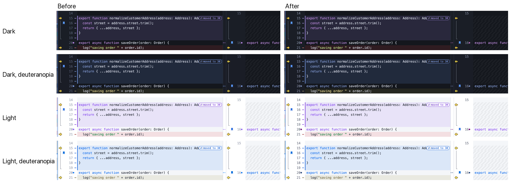
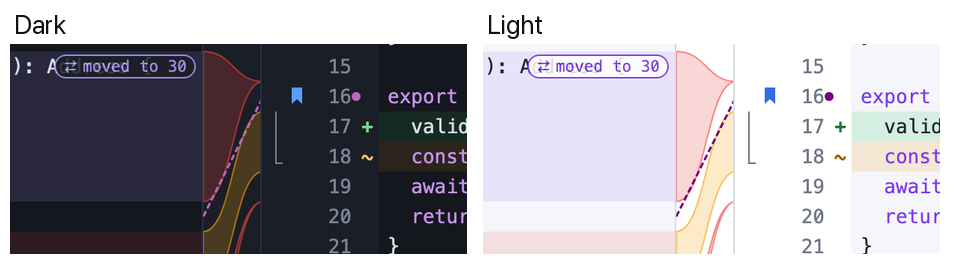
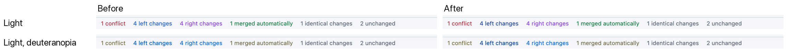
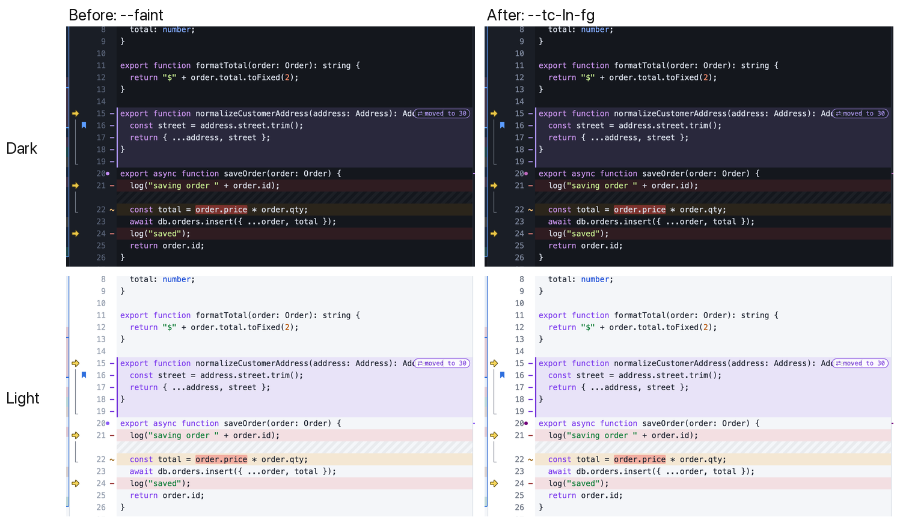

# Colour meaning audit: Text, Folder and Merge

How the diff palette (`src/styles.css`, plus the view tokens in `TextCompare.css`) carries meaning across views, where meanings clash, and what changed. Screenshots are in `docs/screenshots/text/` (Folder Merge: `docs/screenshots/folder/`).

## Method

- **Distance**: Euclidean distance in OKLab × 100 between two colours as drawn (tints composited over `--bg`, text colours on `--panel`). It is measured for normal vision and for simulated protanopia, deuteranopia and tritanopia (Machado 2009, severity 1, linear sRGB). The table gives the **worst** of the four. Below about 10, two colours are easy to mix up at a glance.
- **Contrast**: WCAG 2 contrast ratio against `--panel`.

## What each colour means today

| Colour | Text Compare | Folder Compare | Folder / Text Merge | Elsewhere |
| --- | --- | --- | --- | --- |
| Red (`--different`, `--del-*`) | line only on the left (removed) | file differs; the newer side of a pair is bold red, the older grey | side deleted; conflict rows (bar, name, badge, count); a conflicting side's change | Sync: delete ops, failures; Hex: differing bytes |
| Amber / orange (`--chg-*`, `--warn`) | changed line; edit markers and unsaved state (`--tc-edited` = warn) | error / file facing a folder | side changed; current conflict | warnings everywhere |
| Green (`--add-*`, `--ok`) | line only on the right (added) | — | side added; auto-merged | success |
| Purple (`--orphan`, `--tc-moved-*`) | moved blocks; keywords (syntax) | orphan (one side only) | the right side's change / newer | Sync: create folder |
| Magenta (`--tc-sync`) | sync points (dots beside the line numbers, dashed links) | — | — | — |
| Blue (`--left-fg`, `--bookmark`) | bookmarks | — | the left side's change | — |
| Blue-grey (`--unimportant`) | unimportant text | similar (only unimportant differences); same-but-timestamp clock | — | — |

## Clashes

Worst-case distance, before → after. Rows 3 and 6 were fixed in the [follow-up](#follow-up-sync-points-merge-sides-line-numbers) below.

| # | Where | Tokens | Dark | Light | Outcome |
| --- | --- | --- | --- | --- | --- |
| 1 | Folder status column and folder tone gradients: orphan next to similar | `--orphan` / `--unimportant` | 3.8 → **10.0** | 8.2 → **10.0** | **Fixed** (tokens) |
| 2 | Folder: different vs error rows; Merge: deleted vs changed sides | `--different` / `--warn` | 8.8 (kept) | 2.6 → **7.9** | **Fixed in light**; dark was already near the line. Both also differ in shape (≠ vs ⚠, merge state icons) |
| 3 | Merge: right side's change vs left side's change | `--orphan` / `--left-fg` | 4.5 → **11.2** | 2.0 → 3.9 → **12.2** | Dark fixed by #1; light **fixed in the follow-up** (deeper `--left-fg`) |
| 4 | Red means "different", "newer", "removed", "deleted" and "conflict"; in Folder Compare's split view a red folder row sits over a red removed line | `--different` / `--del-fg` | 1.6 | 2.9 → 8.5 | Kept on purpose (established language). Shapes carry the meaning: ≠ and bold for different/newer in folders, **− glyph** for removed text (new), state icons and ⚠ for merge conflicts |
| 5 | Removed vs added row tints; changed vs removed tints | `--del-bg` / `--add-bg`, `--chg-bg` / `--del-bg` | 1.1, 2.1 | 0.7, 1.7 | Inherent to low-alpha red/green/amber. **Fixed by the change glyphs** (+ − ~ ≈) rather than by colour |
| 6 | Text: sync point vs moved block (both purple); sync dot vs bookmark (blue) | `--tc-sync` / `--tc-moved-fg`, `--bookmark` | 1.5 → **10.9**, 1.0 → **10.1** | 9.5 → **15.7**, 3.8 → **18.6** | **Fixed in the follow-up**: sync points are magenta now. The shapes differ too (dot and dashed link vs tinted rows with a "moved" tag, flag for bookmarks) |
| 7 | Text: changed (amber) vs edit marker (orange) | `--chg-fg` / `--tc-edited` | 3.0 | 1.7 | Not changed: related meanings, different shapes (row tint and ~ vs a bar) |
| 8 | Text: moved-block tag vs keyword colour; Merge: auto-merged vs added green | `--tc-moved-fg` / `--syn-kw`, `--ok` / `--add-fg` | 2.7, 4.0 | 4.6, 0.3 | Not changed: the tag is a bordered pill, and both greens mean "taken in" |

Contrast notes: Text Compare's line numbers use `--tc-ln-fg` (4.5:1 in both themes; they were `--faint`, 2.6:1 dark and 2.5:1 light, until the follow-up). Other views' line numbers still use `--faint`. `--tc-sync` is 4.7:1 dark and 10.6:1 light, so it also works as status-bar text. Every change glyph is at least 5.1:1 in both themes.

## Token changes

| Token | Theme | Before | After | Why |
| --- | --- | --- | --- | --- |
| `--unimportant` | dark | `#7fa6d9` | `#9aadc4` | a quieter slate: unimportant reads as de-emphasised, and its lightness now differs from the orphan purple |
| `--orphan` | dark | `#c38cf5` | `#aa79e5` | a deeper violet (5.2:1), still purple |
| `--orphan` | light | `#8b3fd0` | `#8a3ee0` | a touch bluer, 5.5:1 |
| `--different` | light | `#d0383b` | `#b32c3e` | a deeper red (6.3:1) that no longer has the same lightness as `--warn` |
| `--tc-band-unimp` | dark | from the old unimportant | from the new one | the linked-view band follows `--unimportant` |
| `--chg-glyph`, `--del-glyph`, `--add-glyph` (new) | both | — | row tint made opaque, mixed 70/30 with `--glyph-ink` (white / black) | glyphs follow custom diff colours; they fall back to `--chg-fg` / `--del-fg` / `--add-fg` without relative colour syntax |

No meanings moved: red is still different/removed, amber changed, green added, purple orphans, blue-grey unimportant.

## Change glyphs

Text Compare draws a sign in a 10px slot at the inner edge of each line-number gutter: **+** added (right only), **−** removed (left only), **~** changed, **≈** unimportant (the same sign Folder Compare uses for similar files). Moved lines keep their + or −, in the moved-block colour. The setting is *Settings → Colors → Change glyphs* (or the **…** menu in Text Compare) and is on by default. It works with padding off (linked lines), with the right-side gutter for the left pane, and with blame.

## Follow-up: sync points, merge sides, line numbers

The clashes the first pass left open (rows 3 and 6), and the line-number contrast. Same method; the "keep apart from" lists are every colour drawn next to the token.

| Token | Theme | Before | After | Why |
| --- | --- | --- | --- | --- |
| `--tc-sync` | dark | `#c38cf5` | `#bd69bd` | an orchid (OKLCH hue 327) instead of a violet; 4.7:1 |
| `--tc-sync` | light | `#8b5cf6` | `#710079` | a deep magenta (hue 325); 10.6:1 |
| `--left-fg` | light | `#2563c9` | `#1e439e` | a deeper cobalt (same blue family, hue 264); 8.9:1 |
| `--tc-ln-fg` (new) | dark / light | `--faint` (`#566074` / `#9aa3b2`) | `#7b859a` / `#6f7785` | Text Compare's line numbers: `--faint`'s hue, raised to 4.5:1 |

### Sync points

The sync dot sits in the line-number gutter, next to bookmark flags, the change glyphs and the edit-marker bar, and right below or beside moved blocks. The dashed link crosses the middle column or the linked view's gutter, where the current band is drawn in `--accent` (the same blue as `--bookmark`). Worst case over the four vision types:

| Sync point vs | Dark before → after | Light before → after |
| --- | --- | --- |
| moved block (`--tc-moved-fg`) | 1.5 → **10.9** | 9.5 → **15.7** |
| bookmark flag, current band (`--bookmark` = `--accent`) | 1.0 → **10.1** | 3.8 → **18.6** |
| ≈ glyph (`--unimportant`) | 8.0 → **10.0** | 9.8 → **14.3** |
| − glyph (`--del-glyph`) | 13.7 → 11.1 | 25.8 → 10.6 |
| removed red (`--del-fg`) | 16.9 → 11.2 | 28.1 → 22.8 |
| ~ and + glyphs, edit marker | ≥ 12.1 → ≥ 13.9 | ≥ 13.0 → ≥ 16.1 |

The move toward magenta costs some distance to the reds, but every pair stays above 10. In dark there was little room. Moved blocks, bookmarks, the `≈` slate and the text all sit in the light half, so a sync colour that clears 10 from all of them has to be a mid-lightness orchid. For colour-blind eyes it also sits close to the new line-number grey (4.9 under deuteranopia). That pair carries no meaning (a filled dot is never read as a digit), so it only costs some pop, and the dot keeps its shape. Light had room, so it gets a dark magenta that is 10.6:1 on white. Help (*Linked lines and sync points*) now says "magenta dots".

### Folder Merge: left vs right in light

Light `--left-fg` was a mid blue with nearly the same lightness as the right side's purple (`--orphan`), so the two merged for red-green colour-blind eyes (3.9). The new deeper cobalt is 12.2 from it. As a side effect it also moves away from the auto-merged green under tritanopia (4.5 → 11.5), from the base/unchanged grey (7.0 → 10.0) and from `--accent` (4.3 → 14.2). Dark `--left-fg` is unchanged (11.2 from the right side).

Today the left/right colours show in the status-bar counts ("4 left changes", "4 right changes"). The per-class badge colours in `FolderMerge.css` (`.c-leftChanged .fm-badge` and friends) never apply, because the earlier `.fm-row:not(.c-unchanged) .fm-badge { color: var(--text) }` is more specific. Only the conflict and error badges are coloured. This was left as it is: colouring the badges would be a visible design change, not a palette fix.

### Line numbers

Text Compare's line numbers now use their own token, `--tc-ln-fg`, at 4.5:1 in both themes. That is the WCAG AA level for text, and line numbers are read, not just glanced at (go to line, line references). It keeps `--faint`'s hue and is still the quietest text in the gutter. It sits just under `--muted` (5.3–5.6:1), well under the current section's numbers (`--text`), and under every change glyph (≥ 5.1:1, bold and coloured). The row tints and glyphs still lead. The other views that share `.trow .ln` (patches, database rows) keep `--faint`.

### Still open

- Dark `--left-fg` vs `--ok` (Folder Merge: left change vs auto-merged) is 3.7, and only under tritanopia. The badges carry the words ("Text merged", "Changed on left").
- Dark `--tc-sync` vs `--orphan` is 6.1, but they are never drawn in the same view.
- Rows 4, 5, 7 and 8 above are unchanged.
